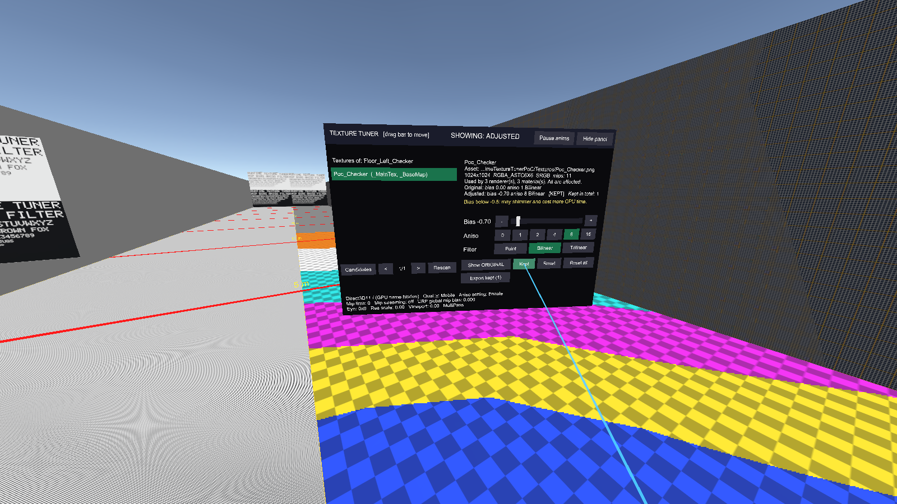
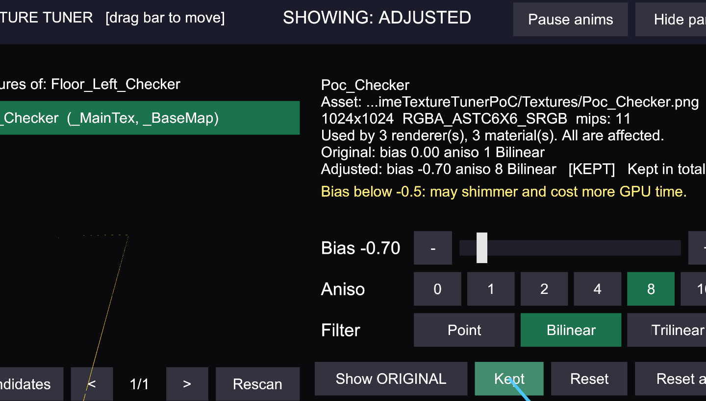
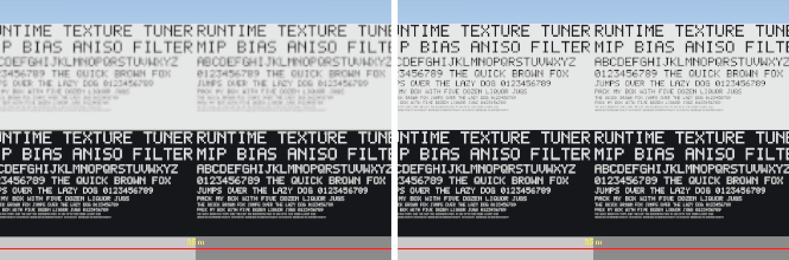
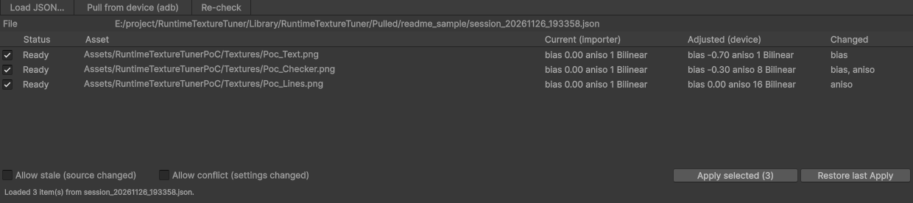

# Runtime Texture Tuner

日本語 | [English](README.en.md)

VR の実機でコンテンツを動かしたまま、テクスチャごとの Mip Map Bias、Aniso Level、Filter Mode を調整するための開発用ツールです。値を変えるたびにビルドとインストールをやり直す必要がなくなります。

実機で決めた値は JSON として PC に持ち帰り、Unity Editor で確認してから `TextureImporter` に反映します。調整用の機能は、専用のシンボルを付けたビルドにだけ含まれます。



*動作確認用のシーンで調整パネルを開き、床のテクスチャを選んだところ。画像は Unity Editor の Play Mode で撮影したものです。*

## 動作を確認した環境

| 項目 | 内容 |
|---|---|
| Unity | 6000.3.27f2 |
| レンダーパイプライン | URP 17.3 |
| 実機 | PICO 4 Ultra（Android、Vulkan、OpenXR 1.15.0） |
| シェーダー | URP の Lit と Unlit |

`package.json` の対象は Unity 6000.0 以降ですが、6000.3.27f2 以外では動かしていません。使っている API が 6000.0 に存在することだけ確認しています。

## インストール

Unity の Package Manager で「Install package from git URL...」を選び、次の URL を入力します。

```
https://github.com/tomoyuki710/RuntimeTextureTuner.git?path=/Packages/com.tn.runtimetexturetuner
```

バージョンを固定する場合は、URL の末尾にタグを付けます。

```
https://github.com/tomoyuki710/RuntimeTextureTuner.git?path=/Packages/com.tn.runtimetexturetuner#v0.1.0
```

Input System、XR Interaction Toolkit、各社の XR SDK には依存しません。

## 使い方

### 1. 調整用ビルドを作る

`Tools > Runtime Texture Tuner > Build Tuning Player...` を選びます。現在のビルド設定（シーン一覧、ビルドターゲット）のまま、スクリプト定義シンボル `RUNTIME_TEXTURE_TUNER_ENABLED` をこのビルドに限って追加します。プロジェクトの設定は書き換えません。

独自のビルド手順がある場合は、次のどちらかで調整用ビルドにできます。

- Build Profile または Player Settings のスクリプト定義シンボルに `RUNTIME_TEXTURE_TUNER_ENABLED` を追加する
- ビルドスクリプトから `TuningBuild.BuildPlayer(options)` を呼ぶ

調整用ビルドでは、ビルド用のシーンのコピーに、テクスチャと元アセットの対応表が追加されます。元のシーンは変更されません。

### 2. 実機で調整する

| 操作 | 内容 |
|---|---|
| 左右のスティックを同時に押し込んで 1 秒 | パネルを開く。開いているときは隠す |
| 右手のレイと右トリガー | パネルのボタンを押す、スライダーを動かす |
| レイを壁や床に向けて右トリガー | その方向にある Renderer を候補として一覧に出す |
| パネル上端の帯をつかんでレイを動かす | パネルを移動する |

パネルは頭の向きには追従せず、置いた場所に留まります。ただし、プレイヤーの移動（カメラの親の移動）には追従するため、タイムラインなどでプレイヤーが移動しても、プレイヤーから見て同じ位置に表示されます。

1. パネルを開き、調整したい物をレイで指してトリガーを引きます。
2. 一覧に候補が近い順に出るので、対象を選びます。選んだ対象は枠線で示されます。
3. その対象が使っているテクスチャの一覧に切り替わるので、調整するテクスチャを選びます。
4. Bias、Aniso、Filter を変えます。
5. `Show ORIGINAL` と `Show ADJUSTED` で見比べ、採用する値で `Keep` を押します。
6. `Hide panel` でパネルを隠して見え方を確かめます。調整値は維持されます。
7. `Export kept` を押すと、Keep した値がアプリのデータ領域に JSON で保存されます。

アニメーションで動いている物を調整するときは、パネル上端の `Pause anims` でシーン内のアニメーションを止められます。`Resume anims` で再開します。パネルを閉じたときも再開します。時間（`Time.timeScale`）は変えないため、止めている間もスティックによる移動や回転はできます。



*調整パネル。左が選んだ物のテクスチャの一覧、右が選んだテクスチャの情報と調整項目です。元アセットのパス、元の値と調整値、注意（ここでは -0.5 より強い負の Bias）が表示されます。*



*約 24 m 先の文字の壁。左が元の値（Bias 0、Aniso 1）、右が調整後（Bias -0.7、Aniso 8）です。PICO 4 Ultra に近い画素密度（約 20 画素/度）で Unity Editor 上に描画し、3 倍に拡大しています。実機の見え方とは異なります。*

対象の選択は Renderer の Bounds との交差で行うため、Collider や Layer の設定は不要です。Bounds は箱による近似なので、遮蔽や重なりは区別できません。候補の一覧から選んで確定してください。

### 3. Editor に反映する

1. 実機を USB で接続し、`Tools > Runtime Texture Tuner > Sessions` を開きます。
2. `Pull from device (adb)` を押して JSON を取得します。ファイルを直接指定する場合は `Load JSON...` を使います。
3. 一覧で、現在の値、実機で調整した値、状態を確認します。
4. 反映する行を選び、`Apply selected` を押します。
5. 元に戻す場合は `Restore last Apply` を押します。



*Sessions ウィンドウ。テクスチャごとに、現在のインポート設定、実機で調整した値、変更した項目、状態が並びます。*

変更されるのは `mipMapBias`、`anisoLevel`、`filterMode` のうち、実機で変えた項目だけです。ソース画像、最大サイズ、圧縮形式などは変更しません。この 3 項目は全プラットフォーム共通のインポート設定なので、Android 以外のプラットフォームにも影響します。

一覧の状態の意味は次のとおりです。

| 状態 | 意味 |
|---|---|
| Ready | 反映できる |
| Unchanged | 既に同じ値になっている |
| Stale | 調整用ビルドの後にソースファイルが変わっている。既定では反映しない |
| Conflict | 調整用ビルドの後に、反映対象の設定が変えられている。既定では反映しない |
| Unsupported | 対象外のアセット |
| Missing | アセットが見つからない |
| Invalid | 項目の内容が不正 |

Apply の記録は `Library/RuntimeTextureTuner/` に保存されます。

### 4. 製品用ビルドを作る

通常の手順でビルドします。`RUNTIME_TEXTURE_TUNER_ENABLED` を付けないビルドには、調整用のコードも対応表も含まれません。

## 持ち帰れるテクスチャ

Editor に持ち帰れるのは、次の条件をすべて満たすテクスチャです。

- `Assets/` 配下にある
- `TextureImporter` を持つ独立したテクスチャアセットである
- 調整用ビルドの時点で、シーン内の Renderer のマテリアルから参照されている

それ以外のテクスチャ（Addressables や AssetBundle で読み込まれるもの、実行時に生成や差し替えをしたもの、`Packages/` 内のもの、他のアセットに埋め込まれたものなど）は、実機で値を変えて見え方を試すことはできますが、持ち帰れません。パネルに理由が表示されます。

## 設定を変える

ボタンの使われ方はコンテンツごとに違うため、割り当てを設定アセットで変えられます。`Assets > Create > Runtime Texture Tuner > Settings` で作成し、`Resources` フォルダーに `RuntimeTextureTunerSettings` の名前で置きます。

| 項目 | 既定値 |
|---|---|
| パネルを開く操作 | 左右のスティックの押し込みを同時に 1 秒 |
| 決定ボタン | 右トリガー |
| レイを出す手 | 右手 |
| Bias の範囲 | -1.0 〜 +2.0（刻み 0.05） |
| パネルを開く距離 | 頭の正面 1.2 m |

`Resources` に置いた設定アセットは製品用ビルドにも含まれます。その場合、製品用ビルドでは中身を読むコードがないため使われませんが、アセット自体は残ります。

### 入力を差し替える

独自の入力の仕組みを持つコンテンツでは、`ITunerInputAdapter` を実装し、`RuntimeTuner.Current.SetInputAdapter(...)` で差し替えられます。既定の実装は `UnityEngine.XR` の `InputDevices` を読みます。

### 調整中に既存の入力を止める

調整機能は既存の入力に干渉しないため、パネルの操作中もコンテンツ側は同じボタン入力を受け取ります。問題になる場合は、`RuntimeTuner.OnTuningModeChanged` を受けて、パネルが開いている間だけコンテンツ側の入力を止めてください。

## 注意と制限

- Unity の公式ドキュメントは、負荷とちらつきの面から -0.5 より強い負の Mip Map Bias を推奨していません。パネルでは -0.5 を下回ると注意が表示されます。
- Mip を持たないテクスチャでは、Bias を変えても見た目は変わりません。
- Quality Settings の Anisotropic Textures が Per Texture 以外の場合、テクスチャごとの Aniso Level は上書きされます。
- `MaterialPropertyBlock` でテクスチャが差し替えられている Renderer では、マテリアルのテクスチャの代わりに、差し替え後のテクスチャが一覧の先頭に `MPB` の印付きで出ます。一覧はトリガーで対象を選んだときに作り直すため、その後にスクリプトが差し替えた場合は `Rescan` を押してください。差し替え後のテクスチャを持ち帰れるのは、調整用ビルドの時点でシーン内のマテリアルからも参照されている場合だけです。
- 共有されているテクスチャの値を変えると、そのテクスチャを使うすべてのマテリアルと Renderer に反映されます。
- 次の場合はテクスチャごとの設定が効かない可能性があります。シェーダーのソースを読んだ範囲での見込みで、実機では確かめていません。
  - Shader Graph で Sampler State ノードをつないでいる場合
  - Shader Graph の Mip Sampling Mode が LOD の場合
  - URP の Terrain Lit のレイヤー 1〜3
- UI など、Renderer 以外だけが参照するテクスチャは対象外です。
- `Pause anims` で止まるのは、押した時点で動いている Animator、タイムライン（PlayableDirector）、パーティクル、Animation コンポーネントです。次の物は止まりません。
  - スクリプトが `Time.deltaTime` などで動かしている物や、ツイーンライブラリで動かしている物
  - シェーダーの `_Time` で動いている物（流れる水、スクロールするテクスチャなど）
  - 押した後に再生が始まった物や、生成された物
  - 更新モードが Manual のタイムライン
- タイムラインのオーディオトラックが止まるかどうかは確かめていません。
- Sessions ウィンドウで一度に読み込めるセッションは 1 つです。
- 実機での動作は PICO 4 Ultra でのみ確認しています。

## ライセンス

MIT License。[LICENSE](LICENSE) を参照してください。
